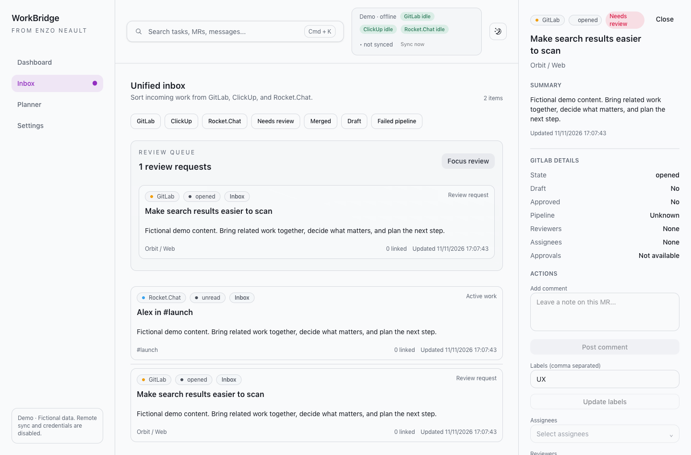
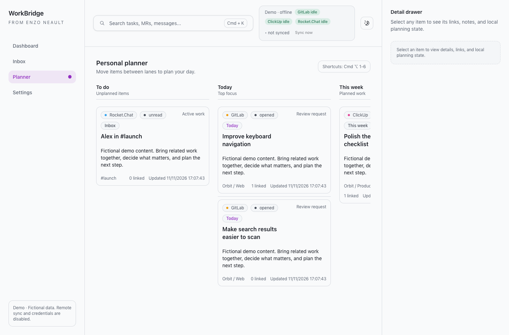
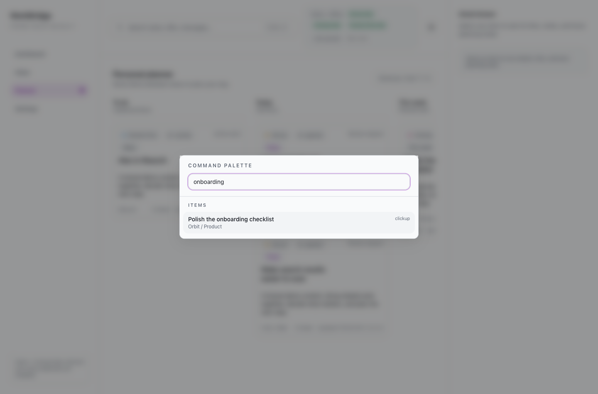
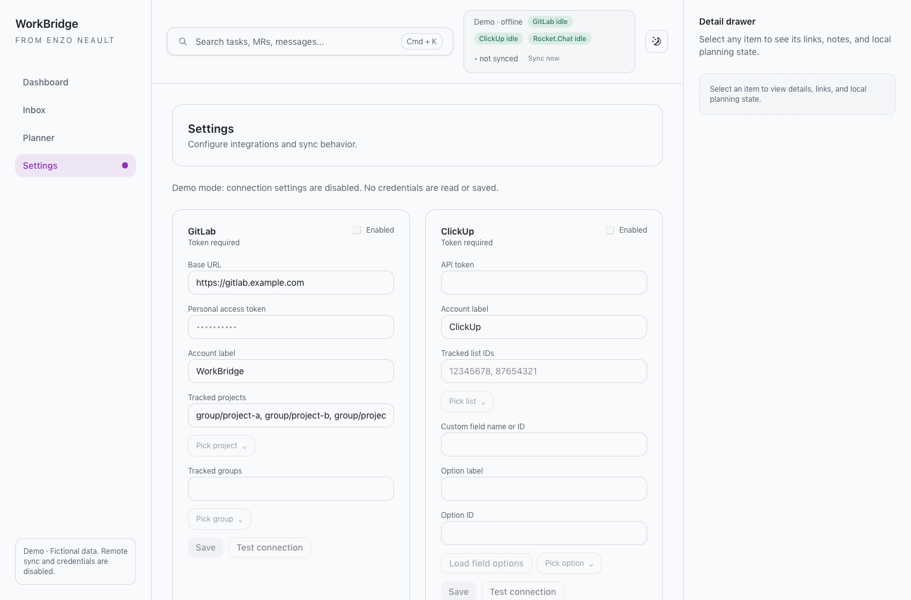

# WorkBridge

[](https://github.com/AzaWoodyy/WorkBridge/actions/workflows/ci.yml)
[MIT](LICENSE) · Desktop workspace for GitLab, ClickUp and Rocket.Chat

A merge request, its task, and the conversation about it often live in three different tabs. WorkBridge brings them into one inbox so you can review the context, link related work, and decide what to do next.

Your planning lanes, priorities and personal notes stay local. Explicit integration actions—such as posting a comment or approving a merge request—write to the connected service.



## What you can do

- Triage merge requests, tasks and messages in a single inbox.
- Keep related work together with manual links and suggested ClickUp references.
- Plan work in Inbox, Today, This week, Later, Waiting and Done.
- Search items and actions with **Cmd+K**. Select an item, then use **Cmd+Option+1–6** to change its lane.
- Read details, keep personal notes, and use supported integration actions without leaving the workspace.



## Try it without accounts

Requires macOS, Git, Node **22.12+** and npm. Node 22 is used in CI. Native dependencies may require Xcode Command Line Tools when a prebuilt binary is unavailable.

```sh
git clone https://github.com/AzaWoodyy/WorkBridge.git
cd WorkBridge
npm ci
npm run demo
```

Demo mode creates a new temporary profile on every launch and seeds fictional work. It never opens your normal database or Keychain credentials. Remote sync, credential writes and integration mutations are blocked in the main process. Planning and search remain interactive. Temporary profiles are disposable; changes do not carry over to the next demo launch.

The screenshots here come from the real Electron app with this mode enabled, including its actual SQLite database and preload bridge. They contain no connected account data.



## Connect your work

Run `npm run dev` for a normal local profile. In **Settings**, configure only the services you need, save a token, select the relevant projects/lists/rooms and enable the connection.

- **GitLab:** base URL, project paths/IDs or groups. Fetches open merge requests; existing cached items are retained when an API result is incomplete.
- **ClickUp:** tracked list IDs and an optional custom dropdown filter. Enter the field name or ID and choose **Load field options** to resolve its ID, then select an option. Existing installations using the old team-filter keys remain readable; saving uses the generic keys.
- **Rocket.Chat:** base URL, user ID, token, rooms and lookback period.

Tokens are stored through the OS credential store. The local SQLite database holds cached work, connection configuration, planning state, links and deletion diagnostics. It is not encrypted. See [SECURITY.md](SECURITY.md) before connecting sensitive work.



## Architecture

```text
Renderer (React + Tailwind)
    │ typed preload API
    ▼
Preload (contextBridge; no Node access in renderer)
    │ validated IPC
    ▼
Main (Electron)
    ├── source-specific handlers → GitLab / ClickUp / Rocket.Chat
    ├── sync orchestration → SQLite via Drizzle
    └── credentials → OS credential store
```

Source-specific panels and controllers live under `src/renderer`. Main-process IPC handlers are grouped under `src/main/ipc`; all arguments pass Zod validation. Navigation is contained in the app, external links are limited to HTTP(S), and the renderer has a Content Security Policy.

**Stack:** Electron 45, React 19, TypeScript, Vite 8, Tailwind CSS 4, TanStack Query, Zustand, Radix UI, Drizzle, better-sqlite3 and Zod. See [dependency notes](docs/DEPENDENCIES.md) for exact upgrade decisions and remaining maintenance risks.

## Development checks

```sh
npm ci --ignore-scripts
npm run test:prepare   # builds real SQLite for Node, explicitly
npm run typecheck
npm run lint
npm run format:check
npm test
npm run build
```

Tests exercise normalization, IPC contracts, sync reconciliation with mocked HTTP and real in-memory SQLite, and migrations on both new and historical databases. They do not require real credentials. GitHub Actions runs these checks on macOS and Ubuntu.

After running tests, prepare native modules for Electron again before starting the app:

```sh
node node_modules/electron/install.js  # needed after --ignore-scripts
npm run postinstall                 # rebuild native modules for Electron
npm run demo
```

`npm run format` formats source files. `npm run db:generate` generates migrations from `src/main/db/schema.ts`; audit triggers are maintained as a custom migration. Migrations are included in the packaged application. Back up your profile before trying changes to persistence.

## Current limits

This is an early personal desktop project, optimized for macOS. Ubuntu CI verifies the logic and build; it does **not** establish Linux desktop support. Windows and signed/notarized distribution are not verified. No auto-updater or hosted account service is included.

The planner uses lane controls and keyboard shortcuts, not drag-and-drop. ClickUp currently retains the French open-status set (`en cours`, `ouvert`, `en validation`). GitLab keeps unseen cached MRs rather than inferring closure from a missing API result. ClickUp and Rocket.Chat connection tests currently validate required input; they do not establish server authentication. Keytar's maintenance status and development-tool advisories remain tracked limitations.

See [CONTRIBUTING.md](CONTRIBUTING.md) to contribute and [SECURITY.md](SECURITY.md) to report a vulnerability. Licensed under MIT.
